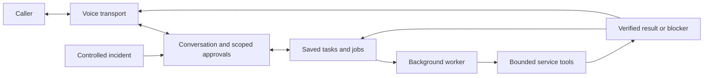

# One shared assistant, two scenarios

This worktree adds `public/connections.*` and `src/integrations/gmail/`: a Composio managed-auth adapter, authenticated connection handlers, and bounded Gmail capability. `createApp(options)` can mount it when the shared core injects dependencies; no-argument preview still connects no services. There is no production in-memory store or duplicate phone/agent core. See [Gmail contracts](GMAIL_INTEGRATION.md) for the required atomic approval/storage boundary and backend deployment gap. The original foundation description below remains the production baseline.

Image email follows the same worker: core image generation → private task-owned asset → injected `resolveImageAsset` → immutable Gmail proposal with image description/byte digest → explicit approval → multipart send/draft → Gmail attachment readback. The module does not generate images or download arbitrary URLs; the core owns generation, image sanitation and asset storage.

This diagram is the target architecture. The implemented foundation is a small static web page and local server; module directories currently contain briefs. Vercel publishes `public/` after the build check. No backend service runs in production yet.

## Module responsibilities

| Location | Responsibility | Present now |
| --- | --- | --- |
| `public/`, `vercel.json` | Minimal public web page and Git-driven deployment | Static HTML/CSS and honest static health JSON |
| `src/app.js`, `src/server.js` | Local preview of the same allowlisted public files | Web page, stylesheet, health and 404/405 responses |
| [core](../src/core/README.md) | General conversation/context, exact approvals, task/job contracts and background execution | Brief only |
| [voice](../src/voice/README.md) | Incoming/outgoing phone transport, caller binding, proactive callback opening | Brief only |
| [integrations](../src/integrations/README.md) | Bounded adapters for existing OpenAI, storage, phone, repository, error and deployment services | Brief only |
| [developer demo](../src/demos/developer/README.md) | Incident-specific input, actions and evidence | Brief only; primary journey |
| [everyday-help demo](../src/demos/everyday-help/README.md) | Older-adult help/reminder example on the same core | Outline only |

## Contracts to agree before implementation

A task needs a type, current revision, structured request and status. An approval binds the current task/revision to a specific action and target. A job references approved work, its attempts and whether an external effect is known, failed or uncertain. A result carries evidence and an honest outcome. These are conceptual requirements, not a new committed schema or API.

Suggested task stages are draft, awaiting approval, queued, running, waiting for a decision, succeeded, blocked and cancelled. Compare these with the existing preparation contracts before deciding field names or migrations. Conversation state remains separate from execution state.

The shared worker chooses registered scenario tools. The scenario supplies capabilities, not a separate personality or global conversation. A pending incident must not prevent an ordinary question or reminder request.

## Implementation boundary

The local server uses Node built-ins so collaborators can run it immediately without credentials or dependency setup. Production currently serves static files only. This does not replace the established service architecture. Introduce reviewed dependencies and backend deployment adapters only with the slice that needs them. Real provider clients, storage schema, scheduler and application interactions remain future work.

All service credentials stay outside the agent-visible coding workspace and public repository. Reuse existing service setup; preserve caller/repository/action authorization. Local health is process evidence only.
