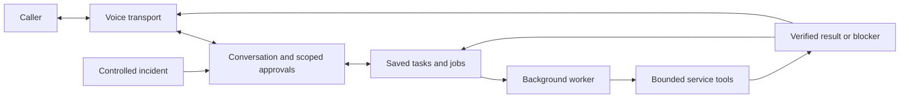

# One shared assistant, two scenarios

> **Current build — 1 November 2026:** The owner has authorized the controlled repair and completion-call flow. See [FAST_INCIDENT.md](FAST_INCIDENT.md) for the implemented path, owner activation and live acceptance checkpoints. Earlier validation-only/static descriptions below are historical. The receiver still returns `not_connected` when the new feature switch is off.

This branch merges main `524f0d4` and adds a runnable single-user Gmail operator lane: `public/gmail.*`, `src/core/gmail-*`, `src/storage/gmail-store.js`, `db/gmail.sql`, and Web Request API entry points around the existing Composio capability. It reuses main's operator token, Supabase project, Vercel pattern and shared HTTP shell, with separate Gmail tables and no dependency on the incident runtime. Default local preview connects no services. See [operator activation](GMAIL_OPERATOR.md) and [Gmail contracts](GMAIL_INTEGRATION.md). The older foundation descriptions below are historical.

Image email follows the same worker: core image generation → private task-owned asset → injected `resolveImageAsset` → immutable Gmail proposal with image description/byte digest → explicit approval → multipart send/draft → Gmail attachment readback. The Gmail adapter does not generate images or download arbitrary URLs. `src/agents/gmail-image.js` implements generation, sanitation and image description using the private task asset store; see [GPT Image integration](GMAIL_IMAGES.md).

This diagram is the target architecture. The incident runtime and Gmail adapter coexist; general phone/caller admission remains a separate integration boundary.

## Module responsibilities

| Location | Responsibility | Present now |
| --- | --- | --- |
| `public/`, `vercel.json` | Minimal public web page and Git-driven deployment | Static HTML/CSS and honest static health JSON |
| `public/gmail.*`, `src/core/gmail-*`, `api/gmail/*`, `api/connections/gmail/*`, `db/gmail.sql` | Single-user Gmail operator, OAuth session, approval and worker | Implemented and offline-tested; owner activation/live acceptance pending |
| `src/app.js`, `src/server.js` | Local preview and shared webhook adapter | Public files, health, webhook method/authentication handling and 404/405 responses |
| `api/webhooks/sentry.js`, `src/integrations/sentry-webhook.js` | Verify the bounded signed demo alert | HMAC, project/tag/release checks and a receipt marked processing not connected; no persistence/worker |
| [core](../src/core/README.md) | General conversation/context, exact approvals, task/job contracts and background execution | Brief only |
| [voice](../src/voice/README.md) | Incoming/outgoing phone transport, caller binding, proactive callback opening | Brief only |
| [integrations](../src/integrations/README.md) | Bounded adapters for existing OpenAI, storage, phone, repository, error and deployment services | Sentry verifier implemented; other adapters planned |
| [developer demo](../src/demos/developer/README.md) | Incident-specific input, actions and evidence | Brief only; primary journey |
| [everyday-help demo](../src/demos/everyday-help/README.md) | Older-adult help/reminder example on the same core | Outline only |

## Contracts to agree before implementation

A task needs a type, current revision, structured request and status. An approval binds the current task/revision to a specific action and target. A job references approved work, its attempts and whether an external effect is known, failed or uncertain. A result carries evidence and an honest outcome. These are conceptual requirements, not a new committed schema or API.

Suggested task stages are draft, awaiting approval, queued, running, waiting for a decision, succeeded, blocked and cancelled. Compare these with the existing preparation contracts before deciding field names or migrations. Conversation state remains separate from execution state.

The shared worker chooses registered scenario tools. The scenario supplies capabilities, not a separate personality or global conversation. A pending incident must not prevent an ordinary question or reminder request.

## Implementation boundary

The local server and verifier use Node built-ins. Production serves static files plus the Node Web Request webhook function. The function consumes only the existing Client Secret/project ID, performs no provider requests and returns a validation receipt. Durable storage/deduplication must be connected before receipt verification can become queued work. Real provider clients, storage schema, scheduler and application interactions remain future work. See [receiver boundaries](SENTRY_WEBHOOK.md).

All service credentials stay outside the agent-visible coding workspace and public repository. Reuse existing service setup; preserve caller/repository/action authorization. Local health is process evidence only.
